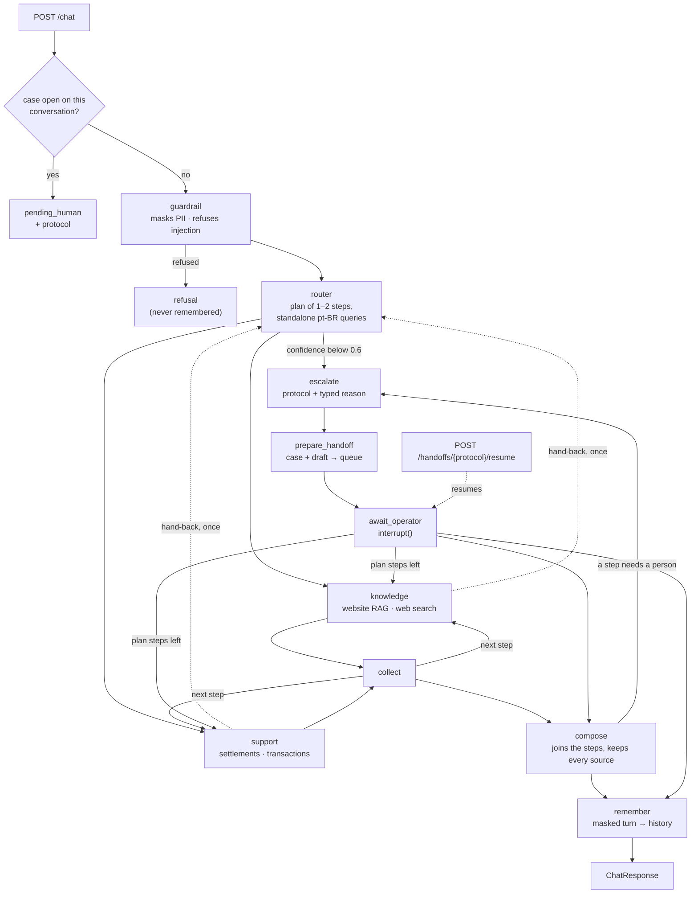

# Multi-agent support system

[](https://github.com/nelsondell/multi-agent-support-system/actions/workflows/ci.yml)

A support service for a payments acquirer (Getnet). One endpoint takes a merchant's message and
answers in Brazilian Portuguese from the acquirer's website, the merchant's own account, a cited
web search, or a human operator, and remembers the conversation. Four agents cooperate behind a
LangGraph orchestration. The rule that governs all of them: **no answer leaves without evidence**.
When the evidence is missing, weak, or the case needs a person, a human gets it, with a protocol.

| | |
| --- | --- |
| **Agents** | router (plans 1–2 steps, replanned within budgets when a step's finding needs another) · knowledge (website RAG, or web search for general questions) · support (3 read tools, and 1 write action behind the merchant's confirmation) · human review (pauses for an operator, then finishes the plan) |
| **Stack** | Python 3.12 · FastAPI · LangGraph · Chroma + BM25 · OpenAI `gpt-6-luna` · Tavily · SQLite, or Postgres for replicas |
| **Run** | `cp .env.example .env`, add two keys, `docker compose up` |
| **Verify** | `make verify`: 363 tests and the offline evals, the eval gate included, no key, no network after the sync; CI runs it on ubuntu with the network cut and on macOS, scans the image and the history |
| **Evals** | error analysis on 100 sampled requests: pass-all 95/100 · red team 40/40 (OWASP ASI01–ASI10) · both replayed in CI ([evals](evals/README.md)) · routing golden set 54/56 over two runs |

v1 was built in the challenge's 60-minute timebox and scored 8.7/10. **v2 is outside that
timebox:** an iteration on the evaluator's feedback, done at the evaluator's invitation. [What
changed since v1](docs/history.md) maps each change to the criterion it answers. **v3 is
T-47 to T-56,** after the V4 evaluation and also at the evaluator's invitation ([Since
V4](#since-v4)).

**Contents** — [Since V4](#since-v4) · [Quick start](#1-quick-start) ·
[Architecture](#2-architecture) · [Evaluation](#3-evaluation) · [Limitations](#4-known-limitations)

**Go deeper** — [evaluator guide](REVIEW.md) · [decisions](docs/adr/) · [pilot](docs/pilot.md) ·
[architecture](docs/architecture.md) (message flow, tools, memory, failures, design questions) ·
[RAG and web search](docs/rag.md) · [human in the loop](docs/human-in-the-loop.md) ·
[demo](docs/demo.md) · [tools](docs/tools.md) · [security](docs/security.md) (identity, audit,
LGPD, OWASP agentic map, guardrail and financial hard rules) · [operations](docs/operations.md)
(configuration, Docker, observability) · [history](docs/history.md) (since v1, process) ·
[spec](specs/spec.md) · [plan](specs/plan.md) · [tasks](specs/tasks.md)

## Since V4

V4 scored 9.5 and named three gaps. **[REVIEW.md](REVIEW.md)** maps all eleven criteria to
evidence, a command and a known limit.

| Gap V4 named | Change | Evidence |
| --- | --- | --- |
| Horizontal scale and HA depend on how storage evolves | Postgres holds checkpoints, the handoff queue and turn locks; `make scale` runs two replicas behind a balancer; LangGraph's own retry and timeout replace the hand-written ones (T-48) | `tests/test_replicas.py` in CI over Postgres: a case escalated on one replica answered on the other, a replica killed mid-turn, turns serialized ([ADR 0006](docs/adr/0006-postgres-for-replicas.md)) |
| The suite did not start locally without `tiktoken`'s download | `tiktoken` declared and its encoding committed; `make verify` from a clean clone with no key, and no network after the sync; CI on ubuntu with the network cut, and on macOS (T-47) | [`reports/verify.md`](reports/verify.md): 363 passed, all checks in 17.3 s |
| Factual evaluation needs a bigger set and human validation | Error analysis on 100 real traces, labels drafted by a reasoning model; every row reviewed by the owner, 0 edits; one binary check per failure mode, replayed on every PR; a 40-case OWASP red team; a retrieval set of 82 questions with reviewed gold chunks (T-51, T-53) | [`evals/eval_report.md`](evals/eval_report.md): pass-all 95/100, red team 40/40; [`evals/rerank_benchmark.md`](evals/rerank_benchmark.md): recall@5 0.939 |

## 1. Quick start

Prerequisites: Docker, make and uv (uv installs Python 3.12 itself).

```bash
make verify                     # frozen sync, then lint, tests and offline evals: no key, no network
```

Only `uv` and `make` are needed. After `uv sync --frozen` nothing touches the network: the tokenizer
ships in the repository, and the tests run with sockets blocked. The result is printed and the tree
is left as it was; `make verify REPORT=1` also records it in
[`reports/verify.md`](reports/verify.md). From a clean copy with an empty uv cache it took 42 s of
sync (468 MB, so mostly the network) and 27.4 s of checks.

```bash
cp .env.example .env            # set OPENAI_API_KEY and TAVILY_API_KEY
make up                         # dev identity keys, then docker compose up; returns once ready
curl -s localhost:8000/ready    # {"status":"ready",...}
./scripts/demo.sh               # the walkthrough in docs/demo.md, with tokens from the dev keys
```

The challenge's payload works too, with a token from the dev keys; a `user_id` that is not the
token's merchant is a 403:

```bash
TOKEN=$(uv run python scripts/dev_auth.py token merchant cliente1988)
curl -s localhost:8000/chat -H "Authorization: Bearer $TOKEN" -H 'Content-Type: application/json' \
  -d '{"message": "Quando cai o dinheiro das vendas de ontem?", "user_id": "cliente1988"}'
```

The first boot builds the knowledge index from the committed corpus snapshot into a volume;
conversations and open cases live in a second volume and survive restarts. Without
`OPENAI_API_KEY` the first boot stops with a one-line fix and writes nothing. `make scale` runs
Postgres, two replicas over it and a round-robin balancer on port 8080 instead
([scaling out](docs/operations.md#scaling-out)). Every setting is in `.env.example` and
[docs/operations.md](docs/operations.md).

```bash
uv sync && uv run python -m app.rag.ingest && uv run uvicorn app.main:app --reload   # local
make models                                    # once, for EMBEDDING_BACKEND=local outside Docker
make eval                                      # the PR-gating evals, live and recorded (both keys)
make eval-offline                              # the same, replayed: no key, no network
uv run python -m evals.run_routing_eval        # routing golden set (needs OPENAI_API_KEY)
uv run python -m evals.run_judge               # LLM judge, 3 runs (needs both keys)
```

## 2. Architecture



| Agent | Decides | Reads | Stops with |
| --- | --- | --- | --- |
| **Router** | intent, a plan of one or two steps, a standalone Portuguese query per step | the message, plus the conversation as data | `low_router_confidence`; `model_unavailable` if its call fails |
| **Knowledge** | answers from the website corpus, or from a web search for `general_info` | retrieved excerpts, or search results | `low_retrieval_confidence`, `insufficient_sources` |
| **Support** | which account tool to call, with which arguments | the merchant's settlements, transactions, or plan and terminal | `individual_case`, `tool_unavailable` |
| **Supervisor** (code, not a model) | between steps: adds a read step a finding asks for, drops an added step that did not answer, stops a turn that spent its budget | each step's structured `needs` and the turn's spend | `budget_exhausted` |
| **Human review** | builds a case and a draft, pauses, turns the operator's reply into the paused step's answer | the case's evidence and the operator's text | — (it is where escalations end) |

The dividing question between knowledge and support is *does answering require reading this
merchant's account?* "My machine won't connect" is the published procedure; "when does yesterday's
money land" reads the account. A compound message gets both, in the order asked. A request whose
next step depends on what a step finds ("quanto custa a mensalidade da minha maquininha?" needs the
merchant's terminal model) gets that step added by the supervisor, bounded
([ADR 0001](docs/adr/0001-bounded-replanning.md)). Policy lives in two files.
`app/graph/build.py` holds the confidence threshold, as a conditional edge, and the hop budget,
which spans the whole plan so two agents cannot pass a message back and forth.
`app/graph/supervisor.py` holds every rule by which a plan may change, and the budgets that stop
it.

The full path of a message, the code layout, memory, failure handling and the design questions are
in [docs/architecture.md](docs/architecture.md); the human-review loop in
[docs/human-in-the-loop.md](docs/human-in-the-loop.md); the guardrail and the financial hard rules
in [docs/security.md](docs/security.md#guardrail-and-financial-hard-rules); the decisions in
[docs/adr/](docs/adr/).

## 3. Evaluation

| What | Result | Where |
| --- | --- | --- |
| Offline suite | 363 tests, under 40 s, sockets blocked, plus 3 that run two replicas over Postgres in CI: every node, every tool, bounded replanning, masking, retrieval, memory, web search, concurrency, three adversarial paths, and the flows over HTTP through the real app and SQLite stores | `tests/` |
| Reproducibility | `make verify` from a clean clone: frozen sync, lint, format, the suite, the guardrail eval and the eval replay, with no key; CI runs it on ubuntu with the network cut and on macOS | [`reports/verify.md`](reports/verify.md) |
| Invariants | every invariant of the spec mapped to the test that pins it | [`specs/plan.md` §11](specs/plan.md) |
| Error analysis | 100 sampled requests on the real model, labelled pass or fail, grouped into five failure modes; one check per mode (four in code, one binary judge from another model family): **pass-all 95/100**; the judge is not validated: the labels hold 5 failures of its mode, 1 held out | [`evals/README.md`](evals/README.md), [`failure_modes.md`](evals/failure_modes.md) |
| Red team | 40 cases tagged OWASP ASI01–ASI10, 10 adaptive, with planted web pages and corpus passages: **40/40 safe** | [`evals/red_team.jsonl`](evals/red_team.jsonl), [`eval_report.md`](evals/eval_report.md) |
| Routing golden set | 28 labelled rows (10 scenarios, compound, follow-ups, turns after an operator's reply): **54/56** over two runs on router prompt v11; both misses are A01, ambiguous by design | [`evals/routing_golden_set.jsonl`](evals/routing_golden_set.jsonl), [`router_benchmark.md`](evals/router_benchmark.md) |
| Planning eval | 20 requests whose next step depends on a finding, three runs: bounded replanning completes **32/60** against 19/60 with it off; the simple requests' p95 moved +5.3, +2.1 and −0.7 s | [`evals/planning_report.md`](evals/planning_report.md) |
| Model benchmark | 5 candidates × the golden set: `gpt-6-luna` low **54/56**, `gpt-6-sol` 54/56 at 19× the cost, `gpt-4o-mini` 46/56 | [`evals/router_benchmark.md`](evals/router_benchmark.md) |
| Retrieval calibration | 3 embedders × 97 questions: the large OpenAI model separates in- from out-of-domain with a 0.067 gap; the local one doesn't | [`evals/retrieval_calibration.md`](evals/retrieval_calibration.md) |
| Reranker benchmark | 82 in-domain questions, gold chunks drafted by a reasoning model; every row reviewed by the owner, 0 edits: Cohere `rerank-v4.0-fast` takes recall@5 from 0.939 to 0.963 and MRR from 0.851 to 0.894 at 618 ms p95, inside the 1 s budget, but stays opt-in: 2 of 82 questions, a new vendor, a trial key's rate limit ([ADR 0002](docs/adr/0002-reranker-off-by-default.md)); bge and Qwen take 5 and 12 s on the CPU | [`evals/rerank_benchmark.md`](evals/rerank_benchmark.md) |
| LLM judge | v2 run, 2026-10-15: 3 independent runs of the ten scenarios, follow-ups, a compound request and the human-review loop; `gpt-6-sol` scores each answered turn against the evidence it had | [`evals/report.md`](evals/report.md) |

Tests assert invariants (route, plan, sources, status, masking, isolation), never a model's wording.
The provider is scripted and the suite reads neither `.env` nor the clock. Evals never run inside
pytest. The gating evals replay a recorded live run in `make verify`, so a code change that
lowers a rate fails CI without a key; a prompt change needs `make eval` to record again.

**Judge (v2 run, 2026-10-15):** groundedness 4.96 ± 0.07 and relevance 4.45 ± 0.05 over three
runs; per-turn notes in [`evals/report.md`](evals/report.md). Real outputs of the ten scenarios, a
follow-up, a compound request, the human loop and the confirmed write, on one node and over two
replicas: [docs/demo.md](docs/demo.md).

## 4. Known limitations

- **Live answers vary.** Web answers depend on what the search returns that minute, and sampling
  moves the judge's scores; [`evals/report.md`](evals/report.md) reports the spread, not one run.
- **The retrieval threshold rests on 97 questions** and a 0.067 gap.
- **Most web pages carry no structured publication date.** A day-dependent answer then shows the
  day its cited page names, labelled as stated by the source, and says it could not confirm a
  date only when the cited page names none.
- **Some rules are prompt-only.** "The site doesn't say X" only when no excerpt treats X, and "a
  forecast is called a forecast", are checked by the judge, not by code. The status guard reads
  words, so it catches "aprovada" for "estornada", not a negation such as "não foi estornada".
- **Router confidence is self-reported**, and A01 ("Quanto eu pago de taxa por venda no crédito?")
  is genuinely ambiguous.
- **Article chunking cuts tables**: a 600-token window can split a fee table mid-row.
- **Mock account data** with dates moved to the current day; **one node over SQLite** unless
  `make scale`; the dev identity provider is a local key pair (production points `AUTH_JWKS_URL`
  at a real one), and the rate limit counts per replica.
- **Latency**: 6.2 s at p50 and 15.1 s at p95 per turn on the 100 sampled requests
  (`evals/traces.csv`), mostly two or three sequential model calls.
