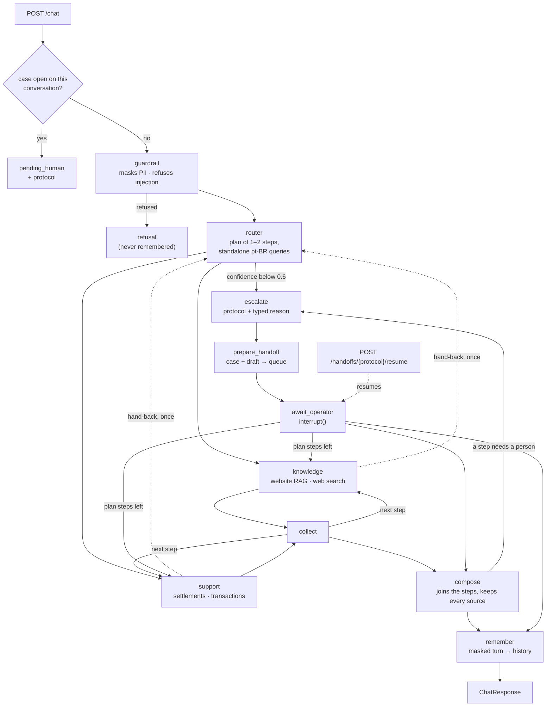

# Multi-agent support system

[](https://github.com/nelsondell/multi-agent-support-system/actions/workflows/ci.yml)

A support service for a payments acquirer (Getnet). One endpoint takes a merchant's message and
answers in Brazilian Portuguese from the acquirer's website, the merchant's own account, a cited
web search, or a human operator, and remembers the conversation. Four agents cooperate behind a
LangGraph orchestration. The rule that governs all of them: **no answer leaves without evidence**.
When the evidence is missing, weak, or the case needs a person, a human gets it, with a protocol.

| | |
| --- | --- |
| **Agents** | router (plans 1–2 steps, replanned within budgets when a step's finding needs another) · knowledge (website RAG, or web search for general questions) · support (3 read tools, and 1 write action behind the merchant's confirmation) · human review (pauses for an operator, then finishes the plan) |
| **Stack** | Python 3.12 · FastAPI · LangGraph · Chroma + BM25 · OpenAI `gpt-6-luna` · Tavily · SQLite, or Postgres for replicas |
| **Run** | `cp .env.example .env`, add two keys, `docker compose up` |
| **Verify** | `make verify`: 362 tests and the offline evals, the eval gate included, no key, no network after the sync; CI runs it on ubuntu with the network cut and on macOS, scans the image and the history |
| **Evals** | error analysis on 100 sampled requests: pass-all 94/100 · red team 40/40 (OWASP ASI01–ASI10) · both replayed in CI ([evals](evals/README.md)) · routing golden set 54/56 over two runs |

v1 was built in the challenge's 60-minute timebox and scored 8.7/10. **v2 is outside that
timebox:** an iteration on the evaluator's feedback, done at the evaluator's invitation. [What
changed since v1](#8-what-changed-since-v1) maps each change to the criterion it answers. **v3 is
T-47 to T-56,** after the V4 evaluation and also at the evaluator's invitation ([Since
V4](#since-v4)).

## Since V4

V4 scored 9.5 and named three gaps. **[REVIEW.md](REVIEW.md)** maps all eleven criteria to
evidence, a command and a known limit.

| Gap V4 named | Change | Evidence |
| --- | --- | --- |
| Horizontal scale and HA depend on how storage evolves | Postgres holds checkpoints, the handoff queue and turn locks; `make scale` runs two replicas behind a balancer; LangGraph's own retry and timeout replace the hand-written ones (T-48) | `tests/test_replicas.py` in CI over Postgres: a case escalated on one replica answered on the other, a replica killed mid-turn, turns serialized ([ADR 0006](docs/adr/0006-postgres-for-replicas.md)) |
| The suite did not start locally without `tiktoken`'s download | `tiktoken` declared and its encoding committed; `make verify` from a clean clone with no key, and no network after the sync; CI on ubuntu with the network cut, and on macOS (T-47) | [`reports/verify.md`](reports/verify.md): 362 passed, all checks in 27.4 s |
| Factual evaluation needs a bigger set and human validation | Error analysis on 100 real traces, labels drafted by a reasoning model; every row reviewed by the owner, 0 edits; one binary check per failure mode, replayed on every PR; a 40-case OWASP red team; a retrieval set of 82 questions with reviewed gold chunks (T-51, T-53) | [`evals/eval_report.md`](evals/eval_report.md): pass-all 94/100, red team 40/40; [`evals/rerank_benchmark.md`](evals/rerank_benchmark.md): recall@5 0.939 |

**Contents** — [Since V4](#since-v4) · [Quick start](#1-quick-start) ·
[Architecture](#2-architecture) · [Message flow](#3-how-a-message-flows) ·
[Human in the loop](#4-human-in-the-loop) · [Demo](#5-demo) · [Evaluation](#6-evaluation) ·
[Hard rules](#7-guardrails-and-hard-rules) ·
[Since v1](#8-what-changed-since-v1) · [Design decisions](#9-design-decisions) ·
[Limitations](#10-known-limitations) · [Process](#11-process)

**Go deeper** — [evaluator guide](REVIEW.md) · [decisions](docs/adr/) · [pilot](docs/pilot.md) ·
[architecture](docs/architecture.md) (workflow, tools, memory, failures) ·
[RAG and web search](docs/rag.md) · [human in the loop](docs/human-in-the-loop.md) ·
[demo output](docs/demo.md) · [tools](docs/tools.md) · [security](docs/security.md) (identity,
audit, LGPD, OWASP agentic map) · [operations](docs/operations.md) (configuration, Docker,
observability) · [spec](specs/spec.md) · [plan](specs/plan.md) · [tasks](specs/tasks.md)

## 1. Quick start

```bash
make verify                     # frozen sync, then lint, tests and offline evals: no key, no network
```

Only `uv` and `make` are needed. After `uv sync --frozen` nothing touches the network: the tokenizer
ships in the repository, and the tests run with sockets blocked. The result is printed and the tree
is left as it was; `make verify REPORT=1` also records it in
[`reports/verify.md`](reports/verify.md). From a clean copy with an empty uv cache it took 42 s of
sync (468 MB, so mostly the network) and 27.4 s of checks.

```bash
cp .env.example .env            # set OPENAI_API_KEY and TAVILY_API_KEY
make up                         # dev identity keys, then docker compose up; returns once ready
curl -s localhost:8000/ready    # {"status":"ready",...}
./scripts/demo.sh               # the walkthrough in §5, with tokens minted from the dev keys
```

The challenge's payload works too, with a token from the dev keys; a `user_id` that is not the
token's merchant is a 403:

```bash
TOKEN=$(uv run python scripts/dev_auth.py token merchant cliente1988)
curl -s localhost:8000/chat -H "Authorization: Bearer $TOKEN" -H 'Content-Type: application/json' \
  -d '{"message": "Quando cai o dinheiro das vendas de ontem?", "user_id": "cliente1988"}'
```

The first boot builds the knowledge index from the committed corpus snapshot into a volume;
conversations and open cases live in a second volume and survive restarts. Without
`OPENAI_API_KEY` the first boot stops with a one-line fix and writes nothing. `make scale` runs
Postgres, two replicas over it and a round-robin balancer on port 8080 instead
([scaling out](docs/operations.md#scaling-out)). Every setting is in `.env.example` and
[docs/operations.md](docs/operations.md).

```bash
uv sync && uv run python -m app.rag.ingest && uv run uvicorn app.main:app --reload   # local
make models                                    # once, for EMBEDDING_BACKEND=local outside Docker
make eval                                      # the PR-gating evals, live and recorded (both keys)
make eval-offline                              # the same, replayed: no key, no network
uv run python -m evals.run_routing_eval        # routing golden set (needs OPENAI_API_KEY)
uv run python -m evals.run_judge               # LLM judge, 3 runs (needs both keys)
```

## 2. Architecture



| Agent | Decides | Reads | Stops with |
| --- | --- | --- | --- |
| **Router** | intent, a plan of one or two steps, a standalone Portuguese query per step | the message, plus the conversation as data | `low_router_confidence`; `model_unavailable` if its call fails |
| **Knowledge** | answers from the website corpus, or from a web search for `general_info` | retrieved excerpts, or search results | `low_retrieval_confidence`, `insufficient_sources` |
| **Support** | which account tool to call, with which arguments | the merchant's settlements, transactions, or plan and terminal | `individual_case`, `tool_unavailable` |
| **Supervisor** (code, not a model) | between steps: adds a read step a finding asks for, drops an added step that did not answer, stops a turn that spent its budget | each step's structured `needs` and the turn's spend | `budget_exhausted` |
| **Human review** | builds a case and a draft, pauses, turns the operator's reply into the paused step's answer | the case's evidence and the operator's text | — (it is where escalations end) |

The dividing question between knowledge and support is *does answering require reading this
merchant's account?* "My machine won't connect" is the published procedure; "when does yesterday's
money land" reads the account. A compound message gets both, in the order asked. A request whose
next step depends on what a step finds ("quanto custa a mensalidade da minha maquininha?" needs the
merchant's terminal model) gets that step added by the supervisor, bounded
([ADR 0001](docs/adr/0001-bounded-replanning.md)). Policy lives in two files.
`app/graph/build.py` holds the confidence threshold, as a conditional edge, and the hop budget,
which spans the whole plan so two agents cannot pass a message back and forth.
`app/graph/supervisor.py` holds every rule by which a plan may change, and the budgets that stop
it.

## 3. How a message flows

1. **`POST /chat`** `{message, conversation_id?}` with a merchant's bearer token. The merchant is
   the token's `sub`, verified against the identity provider's keys; the thread key hashes it with
   the conversation id, so nobody else opens this history. Messages on one conversation run one
   at a time.
2. **Guardrail**, deterministic: masks CPF, CNPJ, card and phone; refuses prompt injection and
   requests for another merchant's data (a merchant naming their own id passes).
3. **Router**: one structured call returns intent, confidence and one or two steps, each a
   standalone Portuguese query that resolves "e o de amanhã?" or "dessa venda" from the history,
   which it reads as data. A rewrite that invents a number or id is discarded.
4. **Specialists** run step by step on their own query, never the history: knowledge retrieves
   (or searches the web for weather and exchange rates), support calls one account tool. The one
   write, a technical ticket for an offline terminal, is only proposed: the turn answers
   `pending_confirmation` with the operation as code renders it, and it runs once the merchant
   sends its `confirm_action_id` ([tools](docs/tools.md)). Between steps, the supervisor may add
   the read step a finding asks for, and checks the turn's call and cost budgets.
5. **Compose** copies one answer, or merges several with a call that may not add a number or
   change a status. A step that needs a person pauses the turn there; the part already answered
   goes out.
6. **Human review** opens a case and pauses; when the operator answers, the plan resumes (§4).
7. **Remember** stores the masked turn. The response cites typed sources: `kb` and `web` with a
   url, `account` with the tool, `operator` with the protocol.

The full path, the code layout, the tools and memory are in [docs/architecture.md](docs/architecture.md).

## 4. Human in the loop

Every escalation goes to a fourth agent. `prepare_handoff` records a case once (what the agents
tried and why they stopped, the pages retrieved, a draft reply) in a SQLite queue, and
`await_operator` pauses the graph with `interrupt()`. The operator approves the draft, replies in
their own words, or cancels. The reply becomes the answer of the step that paused, the plan's
remaining steps run with it as evidence, and compose joins them.

- The merchant's next `/chat` delivers the reply in `delivered`, exactly once, before its own answer;
  `GET /conversations/{id}` shows the history to its merchant only.
- While the case is open, each new message becomes a masked note the operator sees, and nothing runs.
- A rephrasing that adds a number or flips a status is replaced by the operator's own text.
- Cases expire after `HANDOFF_TTL_HOURS` (24); no conversation waits forever. Cases and paused
  threads survive a restart, and two operators cannot both resume one.

The curl walkthrough and every error code: [docs/human-in-the-loop.md](docs/human-in-the-loop.md).

## 5. Demo

`./scripts/demo.sh` against the container built from a clean copy of the code at T-55
(`gpt-6-luna`, `text-embedding-3-large`, live Tavily, RRF), on 2026-10-24 at about 00:17 in
Brazil. The same walkthrough also ran through two replicas over Postgres, and `make observe`
showed the turn's trace in Jaeger. Full output, pt-BR as a merchant gets it:
[docs/demo.md](docs/demo.md).

| # | Question | Agents | Status | Answer, shortened |
| --- | --- | --- | --- | --- |
| S01 | What's the difference between the Get Clássica and the Get Smart? | knowledge | answered | Smart: Android, menus, stock and kitchen messages on the terminal; Clássica: Pix, QR Code, contactless and chip; R$ 79,90 and R$ 129,90 a month when the revenue for exemption is not reached. It leaves out the exemption tiers the excerpts give (failure mode 4). Three pages cited. |
| S02 | What's the weather forecast in Porto Alegre tomorrow? | knowledge (web) | answered | Showers on 25 October, 20.4 °C maximum, 13.5 °C minimum, 75% chance of rain; ends with "Data informada pela própria fonte: 25/10/2026." |
| S03 | When will the money from yesterday's sales be deposited? | support | answered | "O dinheiro das vendas de ontem, R$ 231,26 líquidos, está previsto para cair hoje, 24/10/2026." |
| S04 | Do I need a bank account to receive my sales via Pix? | knowledge | answered | The Get Conta is a digital account that receives and sells through Pix; the site doesn't say whether another bank account is needed. |
| S05 | My card machine won't connect to the internet, what should I do? | knowledge | answered | From the terminal manuals: the steps for error ADQ 1-18 (weak signal) and for ADQ 1-87 (chip not seated); no general reconnect steps without an error code. |
| S06 | How does receivables advance (antecipação) work with Getnet? | knowledge | answered | Receive credit sales before their term for a fee; the Getnet Brasil app shows eligible receivables, simulates the cost and shows the net amount before confirming. |
| S07 | What's the euro exchange rate today? | knowledge (web) | degraded | At midnight no page had the day's rate: "No momento não consigo consultar essa informação na internet com segurança." |
| S08 | My card machine is showing a transaction decline error. | support | answered | "A transação foi negada porque, segundo o banco emissor, havia saldo ou limite insuficiente no cartão." |
| S09 | How many installments can I split a sale into with the crediário? | knowledge | answered | Up to 48 installments; the limit depends on the card issuer's credit policy. |
| S10 | Can I sell through WhatsApp using the Payment Link? | knowledge | answered | "Sim. Você pode vender pelo WhatsApp usando o Link de Pagamento: crie o link e compartilhe por onde quiser." |
| Follow-up | "Quando cai o dinheiro das vendas de ontem?" → "E o de amanhã?" | support, support | answered | R$ 231,26 today; then R$ 60,18 crediting 25/10/2026. |
| Compound | "Quando cai o dinheiro de ontem e como funciona a antecipação?" | support, knowledge | answered | Both parts in one reply, account and website sources. |
| Human review | refund case → operator reply → "E em que dia foi feita essa venda?" | support | paused → answered | The operator's reply delivered with the next message; then "A venda foi feita em 23/10/2026." |
| Write action | a terminal still offline → "Pode abrir, confirmo." → "Confirmo." | support | pending confirmation → answered | The ticket operation rendered by code, run once on confirmation: TKT-92808675; the repeated confirmation returns the same receipt. |

## 6. Evaluation

| What | Result | Where |
| --- | --- | --- |
| Offline suite | 362 tests, under 40 s, sockets blocked, plus 3 that run two replicas over Postgres in CI: every node, every tool, bounded replanning, masking, retrieval, memory, web search, concurrency, three adversarial paths, and the flows over HTTP through the real app and SQLite stores | `tests/` |
| Reproducibility | `make verify` from a clean clone: frozen sync, lint, format, the suite, the guardrail eval and the eval replay, with no key; CI runs it on ubuntu with the network cut and on macOS | [`reports/verify.md`](reports/verify.md) |
| Invariants | every invariant of the spec mapped to the test that pins it | [`specs/plan.md` §11](specs/plan.md) |
| Error analysis | 100 sampled requests on the real model, labelled pass or fail, grouped into five failure modes; one check per mode (four in code, one binary judge from another model family): **pass-all 94/100**; the judge is not validated: the labels hold 5 failures of its mode, 1 held out | [`evals/README.md`](evals/README.md), [`failure_modes.md`](evals/failure_modes.md) |
| Red team | 40 cases tagged OWASP ASI01–ASI10, 10 adaptive, with planted web pages and corpus passages: **40/40 safe** | [`evals/red_team.jsonl`](evals/red_team.jsonl), [`eval_report.md`](evals/eval_report.md) |
| Routing golden set | 28 labelled rows (10 scenarios, compound, follow-ups, turns after an operator's reply): **54/56** over two runs on router prompt v11; both misses are A01, ambiguous by design | [`evals/routing_golden_set.jsonl`](evals/routing_golden_set.jsonl), [`router_benchmark.md`](evals/router_benchmark.md) |
| Planning eval | 20 requests whose next step depends on a finding, three runs: bounded replanning completes **32/60** against 19/60 with it off; the simple requests' p95 moved +5.3, +2.1 and −0.7 s | [`evals/planning_report.md`](evals/planning_report.md) |
| Model benchmark | 5 candidates × the golden set: `gpt-6-luna` low **54/56**, `gpt-6-sol` 54/56 at 19× the cost, `gpt-4o-mini` 46/56 | [`evals/router_benchmark.md`](evals/router_benchmark.md) |
| Retrieval calibration | 3 embedders × 97 questions: the large OpenAI model separates in- from out-of-domain with a 0.067 gap; the local one doesn't | [`evals/retrieval_calibration.md`](evals/retrieval_calibration.md) |
| Reranker benchmark | 82 in-domain questions, gold chunks drafted by a reasoning model; every row reviewed by the owner, 0 edits: Cohere `rerank-v4.0-fast` takes recall@5 from 0.939 to 0.963 and MRR from 0.851 to 0.894 at 618 ms p95, inside the 1 s budget, but stays opt-in: 2 of 82 questions, a new vendor, a trial key's rate limit ([ADR 0002](docs/adr/0002-reranker-off-by-default.md)); bge and Qwen take 5 and 12 s on the CPU | [`evals/rerank_benchmark.md`](evals/rerank_benchmark.md) |
| LLM judge | v2 run, 2026-10-15: 3 independent runs of the ten scenarios, follow-ups, a compound request and the human-review loop; `gpt-6-sol` scores each answered turn against the evidence it had | [`evals/report.md`](evals/report.md) |

Tests assert invariants (route, plan, sources, status, masking, isolation), never a model's wording.
The provider is scripted and the suite reads neither `.env` nor the clock. Evals never run inside
pytest. The gating evals replay a recorded live run in `make verify`, so a code change that
lowers a rate fails CI without a key; a prompt change needs `make eval` to record again.

**Judge (v2 run, 2026-10-15):** groundedness **4.96 ± 0.07** and relevance **4.45 ± 0.05** over
three runs, 16 or 17 scored turns each, run at about 06:30 in Brazil. The judge reads every turn
against the merchant's day. S02 now scores 5 for groundedness in every run: its notice says the date
could not be confirmed, no longer that the source has none. Relevance is held down by S07, which at
that hour found no page with the day's euro rate and answered that it couldn't look it up (2 to 3);
by S01, which left out the Clássica's CPF option or its rental in two runs (3); and by the Payment
Link's first turn, which adds plan prices nobody asked for (3). S05 escalated twice as insufficient
sources. The human-review loop scores 5 in every run.

## 7. Guardrails and hard rules

The guardrail is deterministic and runs before any model call: prompt injection
(`prompt_injection`) and requests for another merchant's data (`identity_swap`) get a refusal and
are never remembered. Identity can't be argued with anyway: the merchant is the `sub` of a signed
token, injected into the tools from graph state and in no schema the model sees. Operators act by
role, every operator action and erasure is in an append-only audit log, and a merchant can erase a
conversation; idle ones are purged after 90 days ([docs/security.md](docs/security.md), with the
OWASP agentic Top 10 mapped to controls and tests). Logs, traces, history and outbound web queries
are masked; ids the system issues are not.

**Financial hard rules**, in the prompts and asserted in tests:

1. No rate, term, limit or amount unless it is literally in an excerpt, an account record, a web
   page or an operator's answer.
2. No promise of a future date; an account forecast is said to be a forecast.
3. No verdict on an individual case beyond the data: a declined sale gets the issuer's recorded
   reason and nothing more; refunds, chargebacks, blocks and fraud always go to a person.
4. Rephrasing adds nothing: a merged answer, a draft or an operator reply with a number or a status
   its source lacks is replaced by that source. Numbers are compared by value ("R$ 1.234,56" =
   "1234.56"), statuses by meaning ("negada" = "recusada"; "estornada" ≠ "aprovada").
5. No mention of a human unless the turn opened a protocol.

Operations: `make observe` adds Prometheus, Grafana and Jaeger. Traces follow OpenTelemetry's GenAI
conventions with no content; metrics give cost per resolution, resolution without a human by
intent, escalations by reason, prompt-cache hit rate and p50/p95 per node; four alerts carry a
runbook line each; vendor failures are stubbed in tests and were drilled once against the stack
([operations](docs/operations.md)).

## 8. What changed since v1

31 tasks (T-15 to T-45), each one commit with a done criterion.

| Criterion (v1 score) | v2 | Tasks |
| --- | --- | --- |
| Memory / multi-turn (1.5) | Persistent threads keyed by merchant and conversation; follow-ups rewritten into standalone queries with history as data; rolling summary; history endpoint; survives restarts | T-19, T-20, T-34, T-42 |
| Human in the loop (5.8) | A fourth agent: case and draft before `interrupt()`; approve, reply or cancel; guarded rephrasing; reply delivered with the next message; notes while waiting; expiry; the plan finishes after the reply; the merchant confirms the one write action | T-21, T-42, T-43, T-50 |
| Infra / Docker (6.8) | One command from a clean clone; index built on first boot; separate state volume; healthcheck; CI builds and smoke-tests the container; `make verify` offline; SBOM, vulnerability and secret scans; digest-pinned base images; replicas over Postgres behind a balancer | T-16, T-17, T-18, T-33, T-47, T-48 |
| Product / completeness (7.5) | Web search for general questions, dated; compound requests; sale vs credit dates; declines explained from the data; partial answers | T-22, T-23, T-30, T-32, T-35, T-38, T-40 |
| Multi-agent (8.8) | Plans of up to two specialists joined by compose; a step that needs a person pauses the plan, which resumes after the operator; hop budget across the plan; bounded replanning: a finding adds a read step for the other specialist, within plan-change, model-call and cost budgets | T-21, T-22, T-43, T-52 |
| Observability / evals (9.1) | Error analysis with one check per failure mode and a 40-case red team, replayed in CI against thresholds; LLM judge over 3 runs; model benchmark; embedder calibration; OpenTelemetry GenAI traces; cost per resolution and cache hit rate; Grafana dashboard and four alerts with runbooks; vendor failures tested | T-25, T-26, T-28, T-29, T-39, T-44, T-51, T-54 |
| Tests / quality (9.2) | 78 → 362 tests; HTTP flows; concurrency; every invariant mapped to a test; suite isolated from `.env` and clock | T-24, T-31, T-44 |
| Architecture / code (9.5) | Same shape, no new framework; one vendor seam; structured output everywhere | every task |
| Security / isolation (9.5) | Merchant identity from a signed JWT; operator roles; append-only audit; LGPD erasure and retention; rate limit; threads bound to the merchant; restricted checkpoint deserializer; masked web queries | T-19, T-21, T-23, T-31, T-44, T-49 |
| RAG / knowledge (9.8) | Embedder chosen by calibration; per-product searches; three-state coverage; conditions stated with prices; FAQ category pages and terminal manuals for the answers left partial; rerankers benchmarked, one opt-in | T-29, T-33, T-37, T-53 |
| Trade-offs (10.0) | Each choice measured and committed: model, embedder, fusion, router effort | T-28, T-29, T-34, T-45 |

## 9. Design decisions

**Memory without coupling agents to the database.** The checkpointer is attached at `compile()`; no
node imports it, and a test fails if one does. Only `messages` and `summary` persist, and only the
router reads them, as data; specialists stay stateless. LangGraph's msgpack decoder would import
any type a checkpoint names, so `app/checkpoints.py` restricts it to the state's own types.

**Really multi-agent.** Each agent owns a decision, its evidence and its ways of stopping, and they
hand work to each other: the router plans; a specialist hands a step back once and the router
replans; compose joins without adding facts; a step that needs a person pauses the plan, and the
plan finishes after the operator answers. Not a router dispatching to one specialist and ending.

**A complete human flow.** `interrupt()` and the checkpointer pause the turn with its state saved;
every side effect happens before the pause, because the paused node re-runs on resume. The
operator's reply is the only new fact the agent may use, and the next turn builds on it. That
needed a measured fix: after an operator named a sale, "E qual foi o valor dessa venda?" lost its
referent. More reasoning effort didn't help; a router rule (prompt v7) that resolves demonstratives
to the entity of the last reply took the 8 follow-up rows of the time from 28/40 to 40/40, 5 runs
each (`evals/router_benchmark.md` at commit 5d36b03). With today's router (v11) the 9 follow-up
rows score 45/45 at low effort and at medium, so the router stays at low.

**Hybrid retrieval.** Embeddings carry an English question into Portuguese prose but blur
near-identical product pages; BM25 pins "Get Smart" against "Get Mini". RRF fuses them by rank;
a reranker was measured and kept opt-in ([ADR 0002](docs/adr/0002-reranker-off-by-default.md)).
Abstention uses dense similarity, calibrated per embedder ([docs/rag.md](docs/rag.md)).

**Failures degrade, never raise.** Every node runs under LangGraph's own timeout and retry; a model
that keeps failing escalates as `model_unavailable` through the node's error handler, an
unreadable account as `tool_unavailable`, and a web search failure becomes a pt-BR notice. Two
requests on one conversation take turns, on any replica, and a turn whose replica dies is finished
from its checkpoint by the retry ([table](docs/architecture.md#failure-handling)).

**Model choice.** `gpt-6-luna` at low effort matched `gpt-6-sol` on routing, 54/56 each, at about
1/19 of the cost ([benchmark](evals/router_benchmark.md)).

## 10. Known limitations

- **Live answers vary.** Web answers depend on what the search returns that minute, and sampling
  moves the judge's scores; [`evals/report.md`](evals/report.md) reports the spread, not one run.
- **The retrieval threshold rests on 97 questions** and a 0.067 gap.
- **Most web pages carry no structured publication date.** A day-dependent answer then shows the
  day its cited page names, labelled as stated by the source, and says it could not confirm a
  date only when the cited page names none.
- **Some rules are prompt-only.** "The site doesn't say X" only when no excerpt treats X, and "a
  forecast is called a forecast", are checked by the judge, not by code. The status guard reads
  words, so it catches "aprovada" for "estornada", not a negation such as "não foi estornada".
- **Router confidence is self-reported**, and A01 ("Quanto eu pago de taxa por venda no crédito?")
  is genuinely ambiguous.
- **Article chunking cuts tables**: a 600-token window can split a fee table mid-row.
- **Mock account data** with dates moved to the current day; **one node over SQLite** unless
  `make scale`; the dev identity provider is a local key pair (production points `AUTH_JWKS_URL`
  at a real one), and the rate limit counts per replica.
- **Latency**: 6.2 s at p50 and 15.1 s at p95 per turn on the 100 sampled requests
  (`evals/traces.csv`), mostly two or three sequential model calls.

## 11. Process

Spec-driven development with Claude Code: `specs/spec.md` (what), `specs/plan.md` (how) and
`specs/tasks.md` (one task per commit, each with a done criterion) were approved before code, and
`CLAUDE.md` carries the non-negotiables. Every commit follows `<type>(<T-id>): <imperative>`, so the
history is the task list. The v1 core went from scaffold to a packaged service in 60 minutes of
commits (T-00 to T-14). v2 came from the v1 evaluation (T-15 to T-27); three fix passes (T-28 to
T-39) followed from real runs in Docker, and later passes (T-40 to T-45) from reviews of the
result. Each finding became a task, and each decision kept its measurement in `evals/`.
