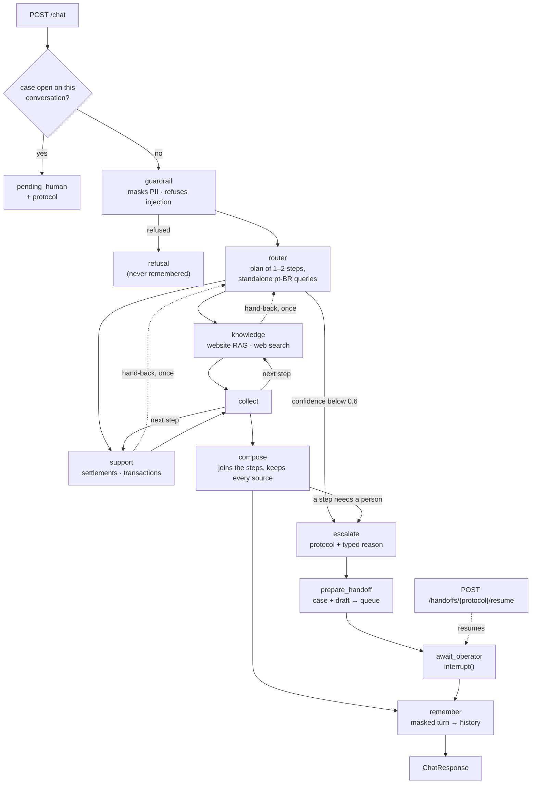

# Multi-agent support system

[](https://github.com/nelsondell/multi-agent-support-system/actions/workflows/ci.yml)

A support service for a payments acquirer (Getnet). One endpoint takes a merchant's message and
answers in Brazilian Portuguese from the acquirer's website, the merchant's own account, a cited
web search, or a human operator, and remembers the conversation. Four agents cooperate behind a
LangGraph orchestration. The rule that governs all of them: **no answer leaves without evidence**.
When the evidence is missing, weak, or the case needs a person, a human gets it, with a protocol.

| | |
| --- | --- |
| **Agents** | router (plans 1–2 steps) · knowledge (website RAG, or web search for general questions) · support (2 account tools) · human review (pauses for an operator, then continues) |
| **Stack** | Python 3.12 · FastAPI · LangGraph · Chroma + BM25 · OpenAI `gpt-6-luna` · Tavily · SQLite |
| **Run** | `cp .env.example .env`, add two keys, `docker compose up` |
| **Tests** | 264 offline tests; CI builds the image and smoke-tests the container |
| **Evals** | routing golden set 27/28 · LLM judge, 3 runs: groundedness 4.88, relevance 4.67 ([report](evals/report.md)) |

**Contents** — [Quick start](#1-quick-start) · [Configuration](#2-configuration) ·
[Architecture](#3-architecture) · [Message workflow](#4-message-workflow) ·
[RAG pipeline](#5-rag-pipeline) · [Tools](#6-tools-and-how-the-llm-is-used) ·
[Memory](#7-memory) · [Human in the loop](#8-human-in-the-loop) · [Demo](#9-demo-real-outputs) ·
[Tests and evals](#10-tests-and-evaluation) · [Observability](#11-observability-guardrails-and-hard-rules) ·
[Since v1](#12-what-changed-since-v1) · [Design notes](#13-design-notes) ·
[Limitations](#14-known-limitations) · [Process](#15-process)

## 1. Quick start

**Docker** — from a fresh clone; nothing is built on the host:

```bash
cp .env.example .env            # set OPENAI_API_KEY and TAVILY_API_KEY; OPERATOR_TOKEN for /handoffs
docker compose up --build       # or `make up`: detached, returns once healthy
curl -s localhost:8000/health   # {"status":"ok"}
OPERATOR_TOKEN=... ./scripts/demo.sh   # the walkthrough in §9
```

The first boot builds the knowledge index from the committed corpus snapshot into the `index`
volume, then starts the API; later boots skip the build. Conversations and open
cases live in a separate `state` volume, so a restart keeps them and rebuilding the index never
deletes one. Without `OPENAI_API_KEY` the first boot stops with a one-line fix and writes nothing.
`API_PORT` moves the host port.

**Local**:

```bash
uv sync
uv run python -m app.rag.ingest           # build the index (from data/raw/, or the snapshot)
uv run uvicorn app.main:app --reload      # http://localhost:8000
```

**Tests and evals**:

```bash
uv run pytest -q                          # 264 offline tests, no network, no cost
uv run ruff check .
uv run python -m evals.run_routing_eval   # routing golden set (needs OPENAI_API_KEY)
uv run python -m evals.run_judge          # LLM judge, 3 runs (needs both keys)
```

## 2. Configuration

Everything is read from the environment or `.env` (`app/settings.py`); `.env.example` documents
every setting. The ones that matter most:

| Variable | Default | Purpose |
| --- | --- | --- |
| `OPENAI_API_KEY` | — | Chat model and embeddings. The API fails fast without it. |
| `TAVILY_API_KEY` | — | Web search for general questions. Without it they get a pt-BR "cannot look this up now". |
| `OPERATOR_TOKEN` | — | Bearer token for `/handoffs`. Unset, those endpoints answer 503. |
| `LLM_MODEL` / `LLM_REASONING_EFFORT` | `gpt-6-luna` / `low` | Chosen in [`evals/router_benchmark.md`](evals/router_benchmark.md). `LLM_TEMPERATURE` is for non-reasoning models only (e.g. `gpt-4o-mini` with `0`). |
| `EMBEDDING_BACKEND` / `EMBEDDING_MODEL` | `openai` / `text-embedding-3-large` | Chosen in [`evals/retrieval_calibration.md`](evals/retrieval_calibration.md). `local` needs no key (CI uses it). Changing it means rebuilding the index. |
| `RETRIEVAL_CONFIDENCE_THRESHOLD` | `0.52` | Below it, the knowledge agent abstains. Calibrated for the default embedder. |
| `ROUTER_CONFIDENCE_THRESHOLD` / `MAX_HOPS` | `0.6` / `2` | Below the first, a turn escalates before any specialist. The second bounds hand-backs. |
| `HISTORY_WINDOW` / `HISTORY_MAX_MESSAGES` | `6` / `12` | Recent messages kept verbatim; past the limit, older ones fold into a summary. |
| `LANGSMITH_TRACING` | `false` | Masked LangSmith tracing (with `LANGSMITH_API_KEY`). |
| `LLM_BACKEND` | `openai` | `fake` answers every call deterministically with no key: CI only. |

## 3. Architecture



| Agent | Decides | Reads | Stops with |
| --- | --- | --- | --- |
| **Router** | intent, a plan of one or two steps, a standalone Portuguese query per step | the message, plus the conversation as data | zero confidence on failure → escalation |
| **Knowledge** | answers from the website corpus, or from a web search for `general_info` | retrieved excerpts, or search results | `low_retrieval_confidence`, `insufficient_sources` |
| **Support** | which account tool to call, with which arguments | the merchant's settlements or transactions | `individual_case`, `tool_unavailable` |
| **Human review** | builds a case and a draft, pauses, turns the operator's reply into the answer | the case's evidence and the operator's text | — (it is where escalations end) |

The dividing question between knowledge and support is *does answering require reading this
merchant's account?* Possessive phrasing decides nothing: "my machine won't connect" is the
published procedure, "when does yesterday's money land" reads the account. A compound message gets
both, in the order asked. Policy is readable in one file, `app/graph/build.py`: the confidence
threshold is a conditional edge, not an `if` inside a node, and the hop budget spans the whole
plan, so two agents cannot pass a message back and forth.

```
app/
  main.py, operator.py      FastAPI: /chat, /health, /metrics; /handoffs for operators
  graph/                    one module per node, plus build.py (edges), state.py, memory.py, numbers.py
  rag/                      parse, chunk, ingest, hybrid retrieval
  tools/                    account.py (two support tools), web.py (Tavily)
  providers/                llm.py (the only vendor import), embeddings.py, fake.py (CI)
  prompts/                  every prompt and pt-BR template, versioned markdown
  observability/            masking, structured logs, metrics, tracing
evals/                      golden set, model benchmark, retrieval calibration, judge, reports
specs/                      spec, plan and task list (spec-driven development)
```

## 4. Message workflow

1. **`POST /chat`** takes `{message, user_id, conversation_id?}`. `user_id` is the authenticated
   caller. The thread key is SHA-256 of `(user_id, conversation_id)`, so another merchant using the
   same conversation id opens an empty thread. If a human has this conversation's case, the answer
   is the open protocol and nothing runs.
2. **Guardrail** masks CPF, CNPJ, card and phone numbers, and refuses prompt injection and
   identity swaps before any model call. A refused message is never remembered.
3. **Router** reads the message, and the last messages and a rolling summary as a separate JSON
   field, never as instructions. It returns a validated `RouterDecision`: intent, confidence, and
   one or two steps, each with a standalone Portuguese query that resolves references ("e o de
   amanhã?", "dessa venda") and, for a comparison, one search per product. A rewrite that invents
   a number or id absent from the conversation is discarded.
4. **Specialists** run step by step, each seeing only its own standalone query, never the history.
5. **Compose** copies a single answer as is, or merges two with one model call that may not add a
   number. A step that needs a person pauses the turn there, under one protocol, and any part
   already answered goes out now; once the operator answers, the remaining steps run and compose
   joins their answers with the operator's. A sentence promising a person is dropped unless a
   protocol was opened.
6. **Escalate → human review** when a step needs a person (§8).
7. **Remember** stores the masked turn and the reply; the response is validated against its own
   contract before it leaves.

```json
{"conversation_id": "c1", "status": "answered", "answer": "...", "intent": "product_info",
 "agents": ["knowledge"], "confidence": 0.98,
 "sources": [{"source_type": "kb", "url": "https://site.getnet.com.br/crediario/", "title": "Crediário - Getnet"}],
 "escalated": false, "escalation": null}
```

`status` is `answered` or `pending_human`. Sources are typed: `kb` and `web` carry a url, `account`
names the tool that read the merchant's data, `operator` names the protocol a human answered.

## 5. RAG pipeline

| Stage | What happens | Where |
| --- | --- | --- |
| **Ingestion** | 18 fetched pages → 133 documents → 148 chunks. Two parsers, each confirmed against a real page: the FAQ (question and answer paired by `data-modal` id) and the article layout (`.fl-col-content`). Extracted text goes to a committed snapshot, so a fresh clone builds the same index without the raw HTML. 600-token chunks with 100 of overlap, deduplicated by content hash (11 duplicates: the same body served under different routes). Four pages match no parser and are reported, not dropped silently. | `app/rag/parse.py`, `chunk.py`, `ingest.py` |
| **Storage** | Chroma (cosine) for vectors, plus `chunks.jsonl` that BM25 is rebuilt from. Chunk ids are content hashes, so re-indexing is idempotent. The index lives in its own Docker volume. Ingestion keeps both halves or neither: a failed first boot leaves nothing a later boot could mistake for an index. | `app/rag/ingest.py` |
| **Retrieval** | Hybrid: dense vectors carry a question across languages, BM25 pins exact product names ("Get Smart" vs "Get Mini"). The two rankings are fused with Reciprocal Rank Fusion by position only. A comparison adds one search per product; their rankings are interleaved, best hit of each first. The whole question is always one of the queries. Confidence is the best dense similarity any query reached; below 0.52 the agent abstains without a model call. | `app/rag/retrieve.py` |
| **Generation** | The model gets only the retrieved excerpts, each labelled with its url, and the financial hard rules, and returns a structured answer with `coverage`: `full`, `partial` (answer what is supported, name what the site doesn't cover) or `none` (abstain, a person takes it). A price that depends on a tier is stated with its condition. Sources are taken from what was retrieved, never from urls the model claims. | `app/graph/knowledge.py`, `app/prompts/knowledge.md` |

**Why these choices, with numbers** ([`evals/retrieval_calibration.md`](evals/retrieval_calibration.md)):
22 questions the corpus answers against 15 it doesn't, through three embedders. Chroma's local
model can't separate them (the best out-of-domain question outscores the worst in-domain one by
0.100); `text-embedding-3-large` separates them completely with a gap of 0.110, so it is the default
and the threshold sits in the middle of that gap. Fusing every query's list at once was measured and
rejected for comparisons: RRF rewards consensus, so generic offer pages crowded out each product's
own page.

**Web search** answers only steps the router labels `general_info` (weather, exchange rates), never
a product question the corpus can't answer. The query that leaves the process is masked and keeps
no number the merchant didn't type in that message, so account data can't leak into it. Pages are
untrusted data: the answer may carry no number they lack and no link of its own. A question about a
day asks for pages from the last day first, and its answer closes with the source's publication
date: taken only from the search provider's structured field, never from page text the model reads,
in the merchant's calendar and without a time of day. A source older than the day in question, or
one with no publication date, gets a plain notice instead. No key, a timeout or a failed check
degrade to a pt-BR message, never an exception.

## 6. Tools and how the LLM is used

- **Two support tools**, `get_settlement_schedule` and `get_transactions`, are LangChain tools whose
  `user_id` is injected from graph state with `InjectedState`. The model never sees it:

  ```
  get_settlement_schedule    model sees: ['date_from', 'date_to', 'date_field']
  get_transactions           model sees: ['limit', 'status']
  ```

  `call_tool` also drops any argument the model is not allowed to set, so a smuggled `user_id` never
  reaches the lookup. The support agent plans in one structured call, the code runs exactly one
  tool, and a second call writes the answer from its result.
- **The account data** is mock, written as of one day and read as of the turn's, so "ontem" and
  "amanhã" always land on data. Settlements are filtered by sale date ("the money from yesterday's
  sales") or credit date ("what lands tomorrow"); their status comes from the credit date against
  today, so an answer can't call settled money a forecast. Amounts reach the model as
  "R$ 1.240,00". A declined sale is answered with the reason the issuer recorded.
- **Structured output everywhere.** Every model call returns a validated Pydantic object; nothing
  parses model prose into a decision.
- **One provider seam.** `app/providers/llm.py` is the only module that imports a vendor SDK. Every
  provider error becomes an answer or an escalation, never a stack trace.
- **Prompts are versioned files** in `app/prompts/`, pt-BR, loaded by name; none lives in Python.

## 7. Memory

A conversation is a LangGraph thread persisted by `AsyncSqliteSaver` in the `state` volume. Only
two things outlive a turn: `messages` (the masked merchant turns and the replies) and `summary` (a
rolling summary of what left the window, folded by one model call; if it fails, nothing is
dropped). Every other field resets when a turn starts. The router is the only agent that reads
history, and it reads it as data; specialists get a standalone query and stay stateless. No node
imports the checkpointer: it is attached when the graph is compiled, and a test enforces that.

```bash
curl -s localhost:8000/chat -H 'Content-Type: application/json' \
  -d '{"message": "Quando cai o dinheiro das vendas de ontem?", "user_id": "cliente1988", "conversation_id": "c1"}'
curl -s localhost:8000/chat -H 'Content-Type: application/json' \
  -d '{"message": "E o de amanhã?", "user_id": "cliente1988", "conversation_id": "c1"}'
```

The second turn reaches support as "Quando cai o dinheiro das vendas de amanhã?". Conversations
survive a restart; the same `conversation_id` under another `user_id` starts empty.

## 8. Human in the loop

Every escalation goes to a fourth agent that pauses the graph with LangGraph's `interrupt()` and
continues the same conversation when an operator answers. It is two nodes because `interrupt()`
re-runs its node on resume: `prepare_handoff` does every side effect once (the case, with what the
agents tried and why they stopped, the pages retrieved and a draft reply, recorded in a SQLite
queue), and `await_operator` only pauses and, on resume, turns the operator's input into the answer
of the step that paused. The graph then goes back into the plan: its remaining steps run with the
operator's text as evidence, within the hop budget, and compose joins everything into the reply.

```bash
# 1. an individual case pauses: status pending_human, with a protocol
curl -s localhost:8000/chat -H 'Content-Type: application/json' \
  -d '{"message": "Por que o estorno da minha venda no Mastercard final 7788 ainda não apareceu?", "user_id": "cliente1988", "conversation_id": "c2"}'
# 2. the operator lists open cases and reads one
curl -s localhost:8000/handoffs -H "Authorization: Bearer $OPERATOR_TOKEN"
curl -s localhost:8000/handoffs/ESC-ECF4B2E5DF -H "Authorization: Bearer $OPERATOR_TOKEN"
# 3. and answers: approve the draft as written, or reply in their own words
curl -s -X POST localhost:8000/handoffs/ESC-ECF4B2E5DF/resume \
  -H "Authorization: Bearer $OPERATOR_TOKEN" -H 'Content-Type: application/json' \
  -d '{"action": "reply", "answer": "Verificamos: o estorno da venda de R$ 89,50 no Mastercard final 7788 foi aprovado hoje, e o valor volta ao comprador em até 2 dias úteis."}'
# 4. the conversation continues, and the next turn builds on the operator's answer
curl -s localhost:8000/chat -H 'Content-Type: application/json' \
  -d '{"message": "E em que dia foi feita essa venda?", "user_id": "cliente1988", "conversation_id": "c2"}'
```

A reply is rephrased for the merchant, but if the rephrasing carries a number the operator didn't
write, the operator's literal text goes out instead. The reply cites the operator and lands in the
history, so step 4 resolves "essa venda" to the sale the operator named. The reply is also held
for the merchant: their next `/chat` delivers it in `delivered`, before that message's own answer,
and `GET /conversations/{id}?user_id=...` shows the whole history. While a case is open, the
conversation answers `pending_human`, records each message as a note the operator sees, and runs
nothing; other conversations are unaffected. An operator can also cancel a case, and every case
expires after `HANDOFF_TTL_HOURS` (24): the merchant's next message then closes it with a notice
and is answered as usual, so no conversation waits forever. Cases and paused threads survive a
restart. Errors: 401 without a valid token, 503 with none configured, 404 for an unknown protocol,
409 for a case already closed, 422 to approve a case with no draft.

## 9. Demo: real outputs

`OPERATOR_TOKEN=... ./scripts/demo.sh` against the container built from this commit's code
(`gpt-6-luna`, `text-embedding-3-large`, live Tavily), on 2026-10-14. Answers are in pt-BR, as a
merchant gets them; web answers change with the live results.

| # | Question | Agents | Status | Answer, shortened |
| --- | --- | --- | --- | --- |
| S01 | What's the difference between the Get Clássica and the Get Smart? | knowledge | answered | Clássica for CPF or CNPJ, Smart only for CNPJ above R$ 10 mil/mês; Smart rental R$ 50,00 from R$ 10 mil, R$ 10,00 from R$ 30 mil, free from R$ 60 mil; otherwise R$ 79,90 vs R$ 129,90/mês. Two product pages cited. |
| S02 | What's the weather forecast in Porto Alegre tomorrow? | knowledge (web) | answered | Thunderstorms on 15/10/2026, 17.3–22.6 °C, 86% chance of rain; then the notice that the source gives no publication date. |
| S03 | When will the money from yesterday's sales be deposited? | support | answered | "O dinheiro das vendas de ontem, R$ 231,26 líquidos, está previsto para cair hoje (14/10/2026)." |
| S04 | Do I need a bank account to receive my sales via Pix? | knowledge | answered (partial) | Sales can be received in the Get Conta, chosen when contracting a machine; the site doesn't say whether a bank account is needed for Pix. |
| S05 | My card machine won't connect to the internet, what should I do? | knowledge | answered (partial) | The Chip Algar connects to several carriers where there is 2G/3G coverage; the site has no troubleshooting steps. In earlier runs it abstained and opened a protocol instead. |
| S06 | How does receivables advance (antecipação) work with Getnet? | knowledge | answered (partial) | Receive credit sales before settlement; automatic advance needs a credit evaluation; rate and how to request not published. |
| S07 | What's the euro exchange rate today? | knowledge (web) | answered | "O euro comercial está cotado a R$ 5,6099." Then the notice that the source gives no publication date. |
| S08 | My card machine is showing a transaction decline error. | support | answered | "Negada porque, segundo o banco emissor, havia saldo ou limite insuficiente no cartão." |
| S09 | How many installments can I split a sale into with the crediário? | knowledge | answered | Up to 48 installments; limit and interest depend on the card issuer, simulated on the machine. |
| S10 | Can I sell through WhatsApp using the Payment Link? | knowledge | answered | "Sim. Você pode vender pelo WhatsApp usando o Link de Pagamento: depois de criar o link, é só compartilhá-lo por onde quiser, inclusive no WhatsApp." |
| Follow-up | "Quando cai o dinheiro das vendas de ontem?" → "E o de amanhã?" | support, support | answered | R$ 231,26 today; then R$ 60,18 crediting 15/10/2026. |
| Compound | "Quando cai o dinheiro de ontem e como funciona a antecipação?" | support, knowledge | answered | Both parts in one reply, account and website sources. |
| Human review | refund case → operator reply → "E em que dia foi feita essa venda?" | support | paused → answered | The operator's reply, rephrased and cited; then "A venda foi feita em 13/10/2026." |

<details>
<summary>Full output of <code>scripts/demo.sh</code></summary>

```
$ OPERATOR_TOKEN=... ./scripts/demo.sh
{"status":"ok"}

=== S01 product comparison ===
> What's the difference between the Get Clássica and the Get Smart?
{
  "status": "answered",
  "agents": [
    "knowledge"
  ],
  "answer": "As duas oferecem recebimento em 2 dias úteis e podem ficar grátis mediante as condições de faturamento. A Get Clássica aparece como opção para CPF e CNPJ; a Get Smart é exclusiva para CNPJ com faturamento acima de R$ 10 mil/mês. O aluguel da Smart varia conforme o faturamento: R$ 50,00/mês a partir de R$ 10 mil, R$ 10,00/mês a partir de R$ 30 mil e grátis a partir de R$ 60 mil. Se não atingir as faixas indicadas, o valor de utilização informado é R$ 79,90/mês para a Clássica e R$ 129,90/mês para a Smart. O site não informa diferenças de funcionalidades ou especificações técnicas entre as maquininhas.",
  "sources": [
    "kb: https://site.getnet.com.br/maquininha/get-classica/",
    "kb: https://site.getnet.com.br/maquininha/get-smart/"
  ],
  "escalation": null
}

=== S02 weather, from the web ===
> What's the weather forecast in Porto Alegre tomorrow?
{
  "status": "answered",
  "agents": [
    "knowledge"
  ],
  "answer": "Em Porto Alegre, amanhã (15 de outubro de 2026), a previsão é de trovoadas, com máxima de 22.6C, mínima de 17.3C e 86% de chance de chuva. Também há previsão de chuva moderada a pontualmente forte na região metropolitana de Porto Alegre.\n\nAtenção: a fonte não informa a data de publicação, então não posso confirmar que o dado está atualizado.",
  "sources": [
    "web: https://www.bra1.com.br/clima/id-698754/previsao_do_tempo_em_porto_alegre__parcialmente_nublado__max_21.5_c_e_84__de_chuva",
    "web: https://www.defesacivil.rs.gov.br/upload/arquivos/202610/14095752-boletim-hidrometeorolo-gico-diurno-14-10-2026.pdf"
  ],
  "escalation": null
}

=== S03 settlement, from the account ===
> When will the money from yesterday's sales be deposited?
{
  "status": "answered",
  "agents": [
    "support"
  ],
  "answer": "O dinheiro das vendas de ontem, R$ 231,26 líquidos, está previsto para cair hoje (14/10/2026).",
  "sources": [
    "account: get_settlement_schedule"
  ],
  "escalation": null
}

=== S04 Pix without a bank account ===
> Do I need a bank account to receive my sales via Pix?
{
  "status": "answered",
  "agents": [
    "knowledge"
  ],
  "answer": "O site informa que, para receber as vendas na Get Conta, você pode escolher essa opção ao contratar uma máquina de aluguel ou compra. Não informa se é necessário ter uma conta bancária para receber vendas via Pix.",
  "sources": [
    "kb: https://site.getnet.com.br/duvidas/"
  ],
  "escalation": null
}

=== S05 connectivity, not in the corpus ===
> My card machine won't connect to the internet, what should I do?
{
  "status": "answered",
  "agents": [
    "knowledge"
  ],
  "answer": "O site informa que, com o Chip Algar, a maquininha pode se conectar a várias operadoras e ser usada em locais com cobertura 2G/3G. Não informa quais etapas seguir para solucionar uma falha de conexão.",
  "sources": [
    "kb: https://site.getnet.com.br/duvidas/"
  ],
  "escalation": null
}

=== S06 receivables advance ===
> How does receivables advance (antecipação) work with Getnet?
{
  "status": "answered",
  "agents": [
    "knowledge"
  ],
  "answer": "Com a antecipação de vendas, você pode receber antes os valores das vendas feitas no crédito, à vista ou parceladas, sem esperar o prazo de compensação. A Antecipação Automática está relacionada à isenção para clientes que optam pelo plano “Receba Conforme suas Vendas” e depende de aprovação de crédito, com avaliação individual de cada contrato. O site não informa as taxas nem todos os detalhes de como solicitar a antecipação.",
  "sources": [
    "kb: https://site.getnet.com.br/duvidas/"
  ],
  "escalation": null
}

=== S07 euro, from the web ===
> What's the euro exchange rate today?
{
  "status": "answered",
  "agents": [
    "knowledge"
  ],
  "answer": "O euro comercial está cotado a R$ 5,6099.\n\nAtenção: a fonte não informa a data de publicação, então não posso confirmar que o dado está atualizado.",
  "sources": [
    "web: https://valor.globo.com/valor-data"
  ],
  "escalation": null
}

=== S08 declined transaction ===
> My card machine is showing a transaction decline error.
{
  "status": "answered",
  "agents": [
    "support"
  ],
  "answer": "A transação foi negada porque, segundo o banco emissor, havia saldo ou limite insuficiente no cartão.",
  "sources": [
    "account: get_transactions"
  ],
  "escalation": null
}

=== S09 crediário installments ===
> How many installments can I split a sale into with the crediário?
{
  "status": "answered",
  "agents": [
    "knowledge"
  ],
  "answer": "O Crediário permite parcelar em até 48 vezes, mas o limite disponível depende das políticas de crédito do emissor do cartão. Você pode conferir as opções e os juros simulando a venda na maquininha.",
  "sources": [
    "kb: https://site.getnet.com.br/crediario/",
    "kb: https://site.getnet.com.br/duvidas/"
  ],
  "escalation": null
}

=== S10 Payment Link on WhatsApp ===
> Can I sell through WhatsApp using the Payment Link?
{
  "status": "answered",
  "agents": [
    "knowledge"
  ],
  "answer": "Sim. Você pode vender pelo WhatsApp usando o Link de Pagamento: depois de criar o link, é só compartilhá-lo por onde quiser, inclusive no WhatsApp.",
  "sources": [
    "kb: https://site.getnet.com.br/link-de-pagamento/"
  ],
  "escalation": null
}

=== Follow-up, turn 1 ===
> Quando cai o dinheiro das vendas de ontem?
{
  "status": "answered",
  "agents": [
    "support"
  ],
  "answer": "O dinheiro das vendas de ontem, R$ 231,26 líquidos, está previsto para cair hoje, 14/10/2026.",
  "sources": [
    "account: get_settlement_schedule"
  ],
  "escalation": null
}

=== Follow-up, turn 2 ===
> E o de amanhã?
{
  "status": "answered",
  "agents": [
    "support"
  ],
  "answer": "O dinheiro das vendas de 12/10/2026, R$ 60,18 líquidos, está previsto para cair amanhã, 15/10/2026.",
  "sources": [
    "account: get_settlement_schedule"
  ],
  "escalation": null
}

=== Compound request ===
> Quando cai o dinheiro de ontem e como funciona a antecipação?
{
  "status": "answered",
  "agents": [
    "support",
    "knowledge"
  ],
  "answer": "O dinheiro das vendas de ontem, R$ 231,26 líquidos, está previsto para cair hoje, 14/10/2026. A antecipação de recebíveis permite receber antes os valores de vendas feitas no crédito, à vista ou parceladas, sem esperar o prazo de compensação para receber o valor na conta.",
  "sources": [
    "account: get_settlement_schedule",
    "kb: https://site.getnet.com.br/duvidas/"
  ],
  "escalation": null
}

=== Human review 1: an individual case pauses ===
> Por que o estorno da minha venda no Mastercard final 7788 ainda não apareceu?
{
  "status": "pending_human",
  "agents": [
    "support"
  ],
  "answer": "Não consegui resolver isso com segurança por aqui, então vou encaminhar para um atendente humano.\nGuarde o número de protocolo ESC-BF2D7CA964 para acompanhar o caso.",
  "sources": [],
  "escalation": {
    "reason": "individual_case",
    "protocol": "ESC-BF2D7CA964"
  }
}

=== Human review 2: the operator reads the case ===
{
  "status": "open",
  "case": {
    "protocol": "ESC-BF2D7CA964",
    "reason": "individual_case",
    "attempts": [
      "router: individual_case, plan support, confidence 0.98",
      "step 1 (support) stopped: an individual case, which only a person may decide; query: Por que o estorno da venda no Mastercard final 7788 ainda não apareceu?"
    ],
    "proposed_draft": "Entendo sua preocupação com o estorno da venda no Mastercard final 7788. Nossa equipe está verificando o caso para entender o que aconteceu e retornará com mais informações."
  }
}

=== Human review 3: the operator replies ===
{
  "status": "answered",
  "answer": "Verificamos que o estorno da venda de R$ 89,50 no Mastercard final 7788 foi aprovado hoje. Segundo a informação da operadora, o valor volta ao comprador em até 2 dias úteis.",
  "sources": [
    "operator: ESC-BF2D7CA964"
  ]
}

=== Human review 4: the next turn builds on the reply ===
> E em que dia foi feita essa venda?
{
  "status": "answered",
  "agents": [
    "support"
  ],
  "answer": "A venda foi feita em 13/10/2026.",
  "sources": [
    "account: get_transactions"
  ],
  "escalation": null
}
```

</details>

## 10. Tests and evaluation

| What | Result | Where |
| --- | --- | --- |
| Offline suite | 264 tests, about 7 s, no network: one module per node, the two tools, masking, retrieval, memory, web search, three adversarial paths, and the v2 flows over HTTP through the real app and SQLite stores | `tests/` |
| Invariants | every v2 invariant of the spec mapped to the test that pins it | [`specs/plan.md` §11](specs/plan.md) |
| CI | ruff, the suite, `docker compose build`, the container started keyless with the fake backend, smoke tests of `/health`, `/metrics` and `/chat` | [`.github/workflows/ci.yml`](.github/workflows/ci.yml) |
| Routing golden set | 28 labelled rows (10 scenarios, compound, follow-ups, turns after an operator's reply): **27/28** against the real router; the miss, A01, is ambiguous by design | [`evals/routing_golden_set.jsonl`](evals/routing_golden_set.jsonl) |
| Model benchmark | 5 candidates × the golden set: `gpt-6-luna` low **54/56**, `gpt-6-sol` 55/56 at 18× the cost, `gpt-4o-mini` 46/56 | [`evals/router_benchmark.md`](evals/router_benchmark.md) |
| Retrieval calibration | 3 embedders × 37 questions: the large OpenAI model separates in- from out-of-domain with a 0.110 gap; the local one doesn't | [`evals/retrieval_calibration.md`](evals/retrieval_calibration.md) |
| LLM judge | 3 independent runs of the ten scenarios, follow-ups, a compound request and the human-review loop; `gpt-6-sol` scores each answered turn against the evidence it had | [`evals/report.md`](evals/report.md) |

Tests assert invariants (route, plan, sources, status, masking, isolation), never a model's wording.
The provider is scripted and the suite reads neither the developer's `.env` nor the clock, so it
passes the same anywhere; repeated runs, in order and shuffled, found no flaky test. Evals never
run inside pytest: a statistical score that dips one row is a signal to read, not a red build.

**Judge summary** (3 runs, every line run three times, no run chosen): groundedness **4.88** in
each of the three runs; relevance **4.67 ± 0.09** (4.59 to 4.76), over 17 scored turns per run.
Every line was answered in all three runs except the refund case, which pauses for a person by
design. Below 4: S01 twice on relevance and once on groundedness, the judge wanting the Get
Clássica's free-from-R$ 10 mil condition set against the Smart's R$ 60 mil; S02 and S07 once each,
where the judge read a date in the page text and marked the "no publication date" notice wrong,
which is the price of taking dates only from the provider's structured field; and the Payment
Link's first turn once, for adding plan prices nobody asked for. S09 retrieved at 0.726 in every
run.

## 11. Observability, guardrails and hard rules

- **Logs.** `structlog` JSON, masked by a processor on every event, so no node can log a CPF even by
  accident; ids the system issues (trace ids, protocols, transaction ids) are never masked away.
  Every node is wrapped by `instrument_node`, so timing and outcome fields are uniform. The merchant
  id is pseudonymised.
- **Metrics.** `GET /metrics`: `support_escalations_total{reason}` and
  `support_node_latency_seconds{node}`. Escalation reasons are a typed enum: `low_router_confidence`,
  `repeated_misroute`, `low_retrieval_confidence`, `insufficient_sources`, `individual_case`,
  `tool_unavailable`, `agent_not_implemented`. In the last timed real run, a turn took 4 to 6.5 s,
  and 9 s for a compound request.
- **Tracing.** Optional LangSmith tracing through one client that masks inputs and outputs before
  upload. Off by default, and off means off: it also overrides a `LANGSMITH_TRACING=true` LangChain
  would otherwise act on, unmasked. It costs nothing per request and can't fail one.
- **Guardrail.** Deterministic, before any model call: prompt injection and identity swaps are
  refused; PII is masked.

**Financial hard rules**, in the prompts and asserted in tests:

1. No rate, term, limit or amount unless it is literally in an excerpt, an account record, a web
   page or an operator's answer.
2. No promise of a future date; an account forecast is said to be a forecast.
3. No verdict on an individual case beyond the data: a declined sale gets the issuer's recorded
   reason and nothing more; refunds, chargebacks, blocks and fraud always go to a person.
4. Rephrasing adds nothing: a merged answer or an operator reply with a number its source lacks is
   replaced by that source. Numbers are compared by value ("R$ 1.234,56" = "1234.56").
5. No mention of a human unless the turn opened a protocol.

## 12. What changed since v1

v1 scored 8.7/10 within the 60-minute timebox. v2 is an iteration on that evaluation's feedback,
done at the evaluator's invitation and outside the timebox: 27 more tasks (T-15 to T-41), each one
commit with a done criterion.

| Criterion (v1 score) | v2 | Tasks |
| --- | --- | --- |
| Memory / multi-turn (1.5) | Persistent threads keyed by merchant and conversation; follow-ups rewritten into standalone queries with history as data; rolling summary; survives restarts; follow-up golden rows 45/45 | T-19, T-20, T-34 |
| Human in the loop (5.8) | A fourth agent: case and draft before `interrupt()`, operator API to approve or reply, guarded rephrasing, the conversation continues and builds on the reply | T-21 |
| Infra / Docker (6.8) | One command from a clean clone; index built on first boot; separate state volume; healthcheck; CI builds and smoke-tests the container; verified with real keys | T-16, T-17, T-18, T-33 |
| Product / completeness (7.5) | Web search for general questions, dated; compound requests; sale vs credit dates; declines explained from the data; partial answers | T-22, T-23, T-30, T-32, T-35, T-38 |
| Multi-agent (8.8) | Plans of up to two specialists joined by compose; a partial answer plus a handoff under one protocol; hop budget across the plan | T-21, T-22 |
| Observability / evals (9.1) | LLM judge over 3 runs; model benchmark; embedder calibration; Prometheus counters; masked tracing | T-25, T-26, T-28, T-29, T-39 |
| Tests / quality (9.2) | 78 → 264 offline tests; HTTP flows; every invariant mapped to a test; suite isolated from `.env` and clock | T-24, T-31 |
| Architecture / code (9.5) | Same shape, no new framework; one vendor seam; structured output everywhere | every task |
| Security / isolation (9.5) | Threads bound to the merchant; restricted checkpoint deserializer; masked web queries; operator token | T-19, T-21, T-23, T-31 |
| RAG / knowledge (9.8) | Embedder chosen by calibration; per-product searches; three-state coverage; conditions stated with prices | T-29, T-33, T-37 |
| Trade-offs (10.0) | Each choice measured and committed: model, embedder, fusion, router effort | T-28, T-29, T-34 |

## 13. Design notes

**1. How do you add multi-turn memory without coupling agents to the database?** The checkpointer
is opened in the API lifespan and handed to `compile()`; no node imports it, and a test fails if one
does. Only `messages` and `summary` persist, and only the router reads them, as data; specialists
get a standalone query and stay stateless, which is also what keeps them testable without a
conversation. Persistence opened one risk worth naming: LangGraph's msgpack decoder imports any type
a checkpoint names, so a writable state store becomes code execution. `app/checkpoints.py`
restricts it to an allowlist of the state's own types (anything else comes back as plain data), and
a test keeps the allowlist in sync with `GraphState`.

**2. What makes it really multi-agent?** Each agent owns a decision, the evidence behind it and its
own ways of stopping, and they hand work to each other: the router plans one or two steps; a
specialist that finds a step isn't its own hands it back once and the router replans; compose joins
two answers without adding facts; and when one part needs a person, the answered part goes out and a
human finishes the rest in the same conversation. It is not a router dispatching to one specialist
and ending.

**3. How does the handoff become a complete human flow?** With `interrupt()` and the checkpointer,
the turn pauses with its state saved and resumes when the operator answers; every side effect
happens before the pause, because the paused node re-runs on resume. The operator's reply is the
only new fact the agent may use (hard rule 4), lands in the history, and the next turn builds on it.
That last step needed a measured fix: after an operator named a sale, "E qual foi o valor dessa
venda?" lost its referent. **Raising reasoning effort did nothing (low and medium both 45/45 on the
follow-up rows); a prompt rule that resolves demonstratives to the entity of the last reply took the
same rows from 28/40 to 40/40.** The router stays at low effort.

**4. Why RRF with BM25 instead of dense retrieval only?** They fail differently. Embeddings carry an
English question into Portuguese prose but blur near-identical product pages; BM25 pins "Get Smart"
against "Get Mini". RRF fuses them by rank, so their incomparable scores never meet. Dense similarity
is still what decides abstention, because a rank says nothing about whether the corpus answers at
all, and that signal was calibrated per embedder rather than assumed (§5).

**5. How does it handle infrastructure failures mid-run?** Every dependency has a defined degraded
path, and none raises to the merchant:

| Failure | Behaviour |
| --- | --- |
| Chat model | Router: zero confidence → escalation. Specialist: the step escalates. Compose: the step answers are joined as written. |
| Embedding API | Nothing retrieved → the step abstains and escalates. |
| Web search | A pt-BR "cannot look this up now"; no escalation. |
| Account store | `tool_unavailable` escalation. |
| API restart | Conversations, open cases and paused threads are in SQLite on a volume. |
| Operator resume fails midway | The case is claimed atomically and reopened on failure, so a second attempt works and two cannot both resume. |
| First boot without a key | One-line fix, nothing written. |
| Tracing | Errors stay in LangSmith's background thread. |

**Prompt injection, tested end to end.** The guardrail refuses it before any model call; identity
can't be argued with because no tool exposes it; and the suite proves it three ways: an injection
planted in turn 1 has no effect on turn 2, a web page that gives orders isn't obeyed, and another
merchant's data is unreachable through the graph.

## 14. Known limitations

- **Live answers vary.** Web answers depend on what the search returns that minute, and model
  sampling moves the judge's scores between runs; [`evals/report.md`](evals/report.md) reports the
  spread rather than one good run.
- **The retrieval threshold rests on 37 hand-written questions** and a 0.110 gap. S01 stays above it
  because the router names the product type in its searches; a phrasing without "maquininha" once
  scored 0.495 against 0.52.
- **Most web pages carry no publication date.** The date stamp comes only from the search
  provider's structured publication date, because a date the model read from page text once took
  the timestamp of another figure on the page. The provider rarely fills that field for weather and
  exchange-rate pages, so those answers usually close with "a fonte não informa a data de
  publicação", and their freshness rests on the provider's last-day search filter.
- **Some rules are prompt-only.** "The site doesn't say X" only when no excerpt treats X, and
  "a forecast is called a forecast", are instructions checked by the judge, not by code.
- **Router confidence is self-reported**, and the benchmark measures routing, not whether that number
  is calibrated. A01 ("Quanto eu pago de taxa por venda no crédito?") is genuinely ambiguous.
- **Article chunking cuts tables**: a 600-token window can split a fee table mid-row. Structural
  chunking is the highest-value next fix.
- **Mock account data.** `data/customers.json` stands in for an account API; its dates are moved to
  the current day.
- **Single process, SQLite**, `user_id` trusted from the request, one shared operator token, no rate
  limiting: fit for the challenge, not for production traffic.
- **Four pages are not indexed**: two render with JavaScript, two come from the English site's
  different stack.
- **Latency**: 4 to 9 s per turn, mostly two or three sequential model calls.

## 15. Process

Spec-driven development with Claude Code: `specs/spec.md` (what), `specs/plan.md` (how) and
`specs/tasks.md` (one task per commit, each with a done criterion) were approved before code, and
`CLAUDE.md` carries the non-negotiables. Every commit follows `<type>(<T-id>): <imperative>`, so the
history is the task list. The v1 core went from scaffold to a packaged service in 60 minutes of
commits (T-00 to T-14). **v2 is outside that timebox:** it is an iteration on the evaluator's
feedback on v1, done at the evaluator's invitation, and
[What changed since v1](#12-what-changed-since-v1) maps each change to the criterion it answers. v2 came from the v1 evaluation (T-15 to T-27), and three fix passes
(T-28 to T-39) followed from real runs in Docker. Each run's findings became tasks, and each
decision kept its measurement in `evals/`.
